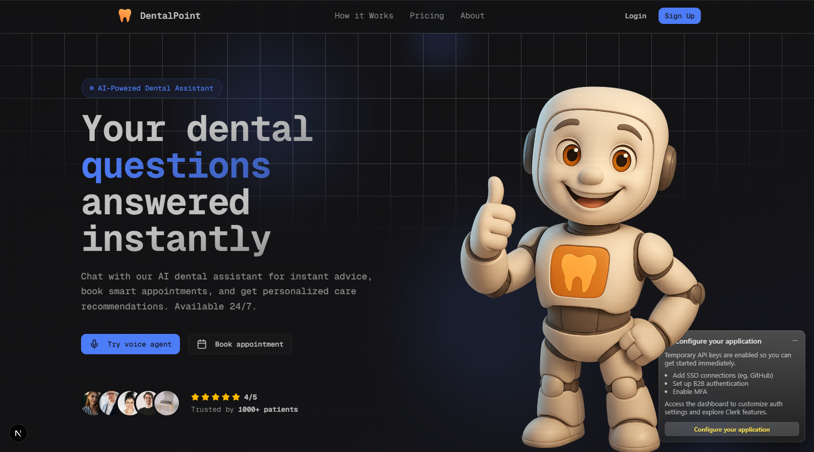
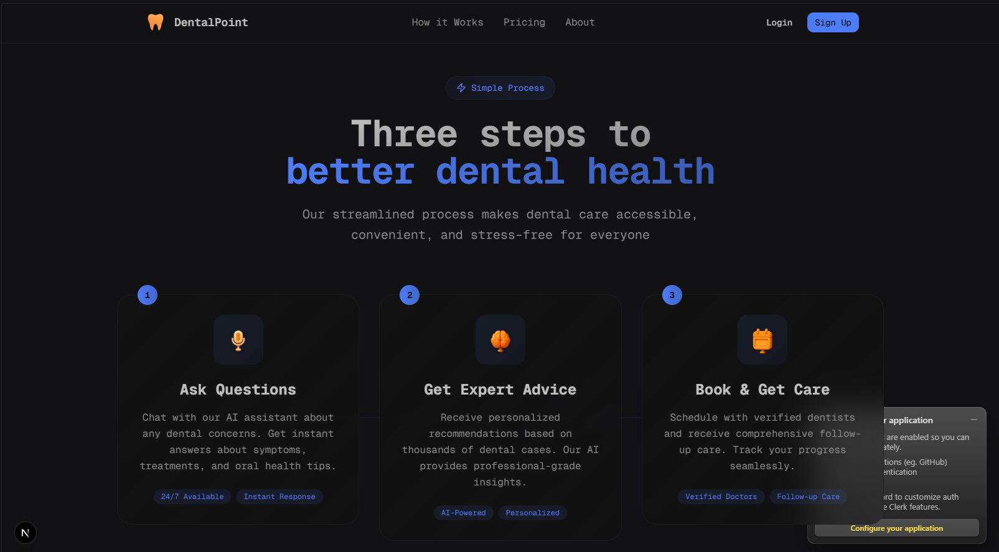
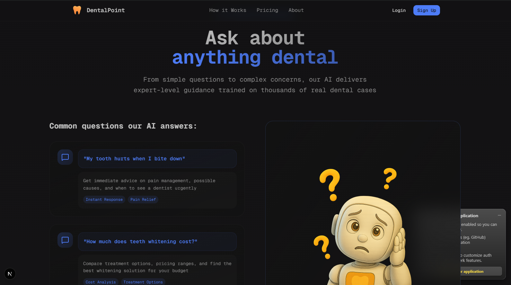
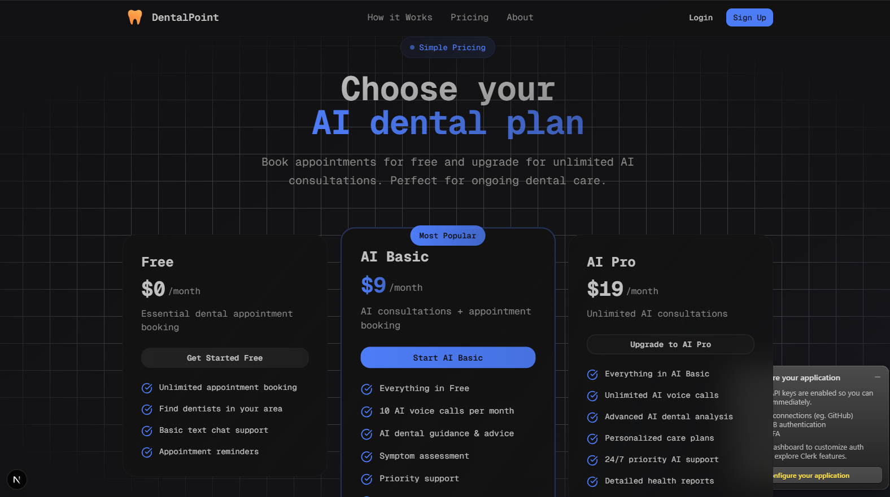
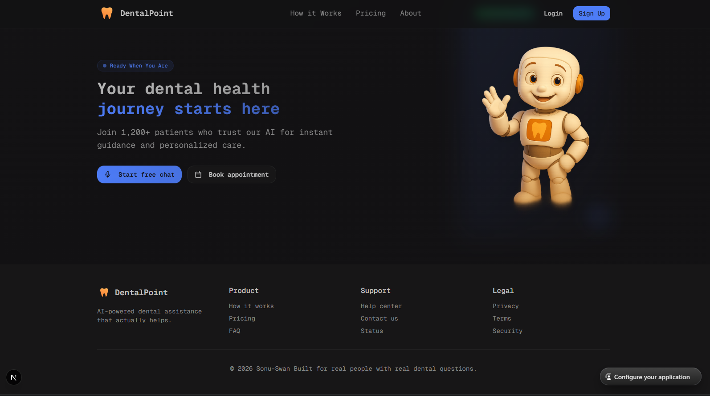

<h1 align="center">🦷 DentalPoint — AI-Powered Dental Platform</h1>

<p align="center">
  A full-stack dental platform with an AI voice agent, smart appointment booking, and subscription billing — built for real people with real dental questions.
</p>

<p align="center">
  
  
  
  
  
  
</p>

---

## 📸 Preview

<table>
  <tr>
    <td></td>
    <td></td>
  </tr>
  <tr>
    <td></td>
    <td></td>
    <td></td>
  </tr>
</table>

<p align="center"></p>

---

## ✨ Highlights

- 🏠 Modern landing page with gradients, imagery, and a 3D mascot
- 🔐 Authentication via Clerk (Google, GitHub, Email & Password)
- 🔑 Email verification with 6-digit codes
- ❓ FAQ section showcasing common dental questions the AI can answer
- 📅 Full appointment booking system
- 🦷 3-step booking flow — Dentist → Service & Time → Confirm
- 📩 Automated booking email notifications via Resend
- 📊 Admin dashboard for managing appointments
- 🗣️ AI voice agent powered by Vapi (Pro plan feature)
- 💳 Subscription billing via Clerk — Free plan + 2 paid tiers
- 🧾 Automatic email invoicing
- 💸 Prorated plan upgrades — pay only the difference
- 📂 PostgreSQL for data persistence, managed with Prisma
- 🎨 UI built with Tailwind CSS + shadcn/ui
- ⚡ Data fetching with TanStack Query
- 🤖 CodeRabbit for automated PR review
- 🧑‍💻 Git/GitHub workflow — feature branches, PRs, merges
- 🚀 Deployed on Sevalla

---

## 🛠️ Tech Stack

| Layer            | Technology                              |
|-------------------|------------------------------------------|
| Framework         | Next.js (App Router, TypeScript)         |
| Styling           | Tailwind CSS, shadcn/ui                  |
| Auth & Billing    | Clerk                                    |
| Database          | PostgreSQL + Prisma ORM                  |
| Data Fetching     | TanStack Query                           |
| AI Voice Agent    | Vapi                                     |
| Email             | Resend                                   |
| Code Review       | CodeRabbit                               |
| Deployment        | Sevalla                                  |

---

## 🚀 Getting Started

### 1. Clone the repo

```bash
git clone https://github.com/sonu-swan/dentalpoint.git
cd dentalpoint
```

### 2. Install dependencies

```bash
npm install
```

### 3. Set up environment variables

Create a `.env` file in the project root:

```env
DATABASE_URL=

NEXT_PUBLIC_CLERK_PUBLISHABLE_KEY=
CLERK_SECRET_KEY=

RESEND_API_KEY=

NEXT_PUBLIC_VAPI_ASSISTANT_ID=
NEXT_PUBLIC_VAPI_API_KEY=

ADMIN_EMAIL=

NEXT_PUBLIC_APP_URL=http://localhost:3000
```

### 4. Generate the Prisma client and push the schema

```bash
npx prisma generate
npx prisma db push
```

### 5. Run the dev server

```bash
npm run dev
```

Visit **http://localhost:3000**.

---

## 📁 Project Structure

dentalpoint/
├── .clerk/
├── docs/
│   └── preview/              # README preview screenshots
├── prisma/                  # Database schema & migrations
├── public/                  # Static assets
├── src/
│   ├── app/                  # Next.js App Router pages
│   ├── components/
│   │   ├── admin/             # Admin dashboard components
│   │   ├── appointments/      # Booking flow components
│   │   ├── dashboard/         # User dashboard components
│   │   ├── emails/            # Resend email templates
│   │   ├── landing/           # Landing page sections
│   │   ├── providers/         # Context/providers
│   │   ├── ui/                 # shadcn/ui components
│   │   ├── voice/             # Vapi AI voice agent components
│   │   ├── Navbar.tsx
│   │   └── UserSync.tsx
│   ├── hooks/
│   │   ├── use-appointments.ts
│   │   ├── use-doctors.ts
│   │   └── use-mobile.ts
│   ├── lib/                   # Prisma client, server actions, utilities
│   └── middleware.ts          # Clerk auth middleware
├── biome.json                # Linting/formatting config
├── components.json           # shadcn/ui config
├── next.config.mjs
├── package.json
├── postcss.config.mjs
└── tsconfig.json
🧑‍💻 Contributing
Create a feature branch: git checkout -b feature/your-feature
Commit your changes with clear messages
Open a PR — CodeRabbit will auto-review it
Merge after review
📄 License

This project is open for personal and educational use. Add a license file if you plan to open-source it publicly.

<p align="center">Built by <a href="https://github.com/sonu-swan">Sonu Paswan</a></p>